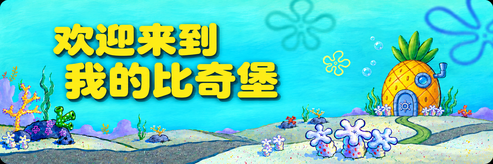

  

<b>🧽 保持好奇，慢慢升级。今天也要学会一点新东西！</b>

  <a href="#-菠萝屋里的我">我的故事</a> ·
  <a href="#-蟹堡王工具箱">我的小工具</a> ·
  <a href="#-水母田探索记录">探索记录</a>

## 🍍 菠萝屋里的我

如果把我的学习生活搬到比奇堡，菠萝屋里大概会有两张桌子：一张摊着临床医学课本，另一张亮着刚打开的代码编辑器。

我是一名**在读临床医学学生**，也是编程和人工智能世界里的新手。遇到不懂的知识，就像海绵宝宝追水母一样：先被好奇心吸引，再一点点摸清它的规律。代码偶尔会打结，知识也需要反复消化，但每弄明白一点，就像捡到一枚小贝壳。

我想慢慢攒起这些小本领，做出能解决真实问题的小工具。也希望有一天，能把人工智能运用到未来的临床中，让技术更好地帮助医生和患者。

> 故事还在开头。先认真学医，再认真探索，把每一个小进步攒成下一步的底气。

<table>
<tr>
<td width="33%" align="center"><h3>🩺 医学课本</h3>临床医学在读 打好医学基础</td>
<td width="33%" align="center"><h3>💻 代码练习</h3>从小工具开始 动手学习编程</td>
<td width="33%" align="center"><h3>🪼 好奇实验</h3>学习人工智能 探索临床应用</td>
</tr>
</table>

## 🍔 蟹堡王工具箱

### 📚 论文引用小助手

**把论文里的纯文本引用，重新连接到文献管理工具。**

这是我的开源小工具：把文档中的纯文本引用转换为文献管理软件可识别的域代码，支持文档扫描、引用转换与结果核对，让重复的文献处理工作更省心。

[🧰 打开工具仓库](https://github.com/hmbbjack/reverse-zotero-insert) · [📖 阅读使用说明](https://github.com/hmbbjack/reverse-zotero-insert#readme)

## 🪼 水母田探索记录

这里收着我正在关注、学习或参与的开源项目。**以下是派生仓库，原作者与上游项目见各仓库说明。**

| 探索方向 | 我的小角落 |
| :--- | :--- |
| 🛠️ 编程助手与桌面工具 | [桌面工具探索](https://github.com/hmbbjack/cockpit-tools) |
| 🫧 智能体与开发工作流 | [智能体工作台探索](https://github.com/hmbbjack/cc-haha) |
| 🐚 模型接口与应用连接 | [模型接口探索](https://github.com/hmbbjack/new-api) |

  

<b>学习不必一口气游完整片海，今天向前一点就很好。</b> 感谢你游到这里。欢迎逛逛我的仓库，一起学习、一起进步。🧽

🐚 主题与素材说明

本页为个人兴趣主题。海绵宝宝角色及相关形象属于其权利方，与本账号无隶属关系。头像选自[海绵宝宝官方频道](https://www.youtube.com/channel/UCx27Pkk8plpiosF14qXq-VA)的公开头像素材。封面参考[比奇堡背景素材](https://www.themoviedb.org/tv/387-spongebob-squarepants/images/backdrops)，通过人工智能工具制作与调整。

