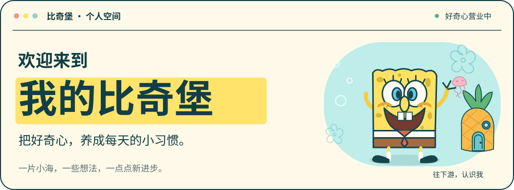
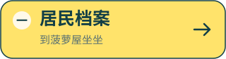
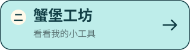
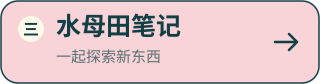
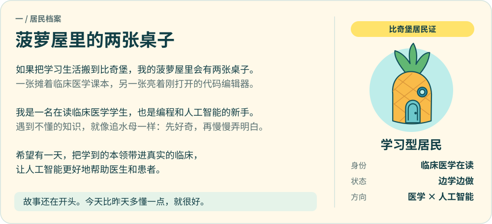
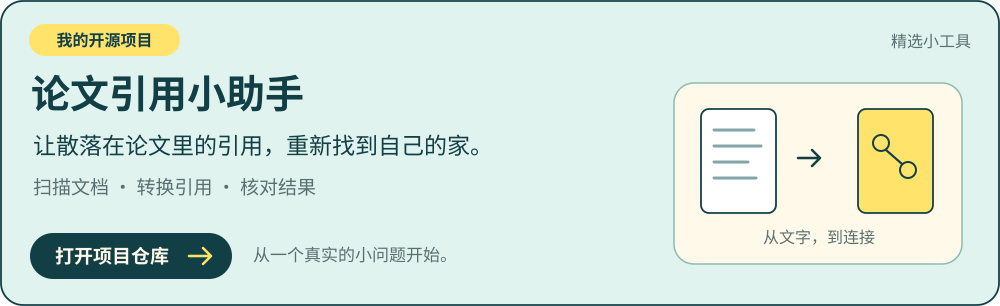
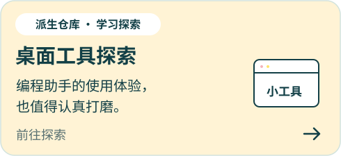
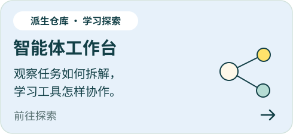
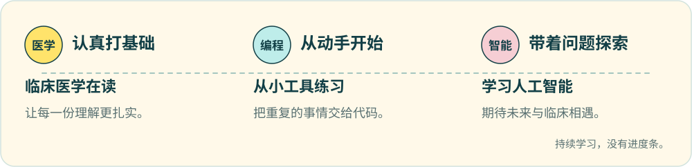

<picture>
  <source media="(max-width: 767px)" srcset="assets/v2/hero-mobile.svg" />
  
</picture>

  <a href="#user-content-居民档案"><picture><source media="(max-width: 767px)" srcset="assets/v2/nav-about-mobile.svg" /></picture></a>
  <a href="#user-content-蟹堡工坊"><picture><source media="(max-width: 767px)" srcset="assets/v2/nav-projects-mobile.svg" /></picture></a>
  <a href="#user-content-水母田笔记"><picture><source media="(max-width: 767px)" srcset="assets/v2/nav-learning-mobile.svg" /></picture></a>

<picture>
  <source media="(max-width: 767px)" srcset="assets/v2/about-mobile.svg" />
  
</picture>

读一读我的海底小故事

如果把学习生活搬到比奇堡，我的菠萝屋里会有两张桌子：一张摊着临床医学课本，另一张亮着刚打开的代码编辑器。

我是一名**在读临床医学学生**，也是编程和人工智能世界里的新手。遇到不懂的知识，就像海绵宝宝追水母一样：先好奇，再慢慢弄明白。

我希望慢慢攒起这些本领，做出能解决真实问题的小工具。也希望有一天，把人工智能运用到未来的临床中，让技术更好地帮助医生和患者。

故事还在开头。今天比昨天多懂一点，就很好。

<picture>
  <source media="(max-width: 767px)" srcset="assets/v2/projects-title-mobile.svg" />
  
</picture>

<a href="https://github.com/hmbbjack/reverse-zotero-insert">
<picture>
  <source media="(max-width: 767px)" srcset="assets/v2/project-feature-mobile.svg" />
  
</picture>
</a>

<a href="https://github.com/hmbbjack/cockpit-tools"><picture><source media="(max-width: 767px)" srcset="assets/v2/project-desktop-mobile.svg" /></picture></a>
<a href="https://github.com/hmbbjack/cc-haha"><picture><source media="(max-width: 767px)" srcset="assets/v2/project-agents-mobile.svg" /></picture></a>

<picture>
  <source media="(max-width: 767px)" srcset="assets/v2/learning-title-mobile.svg" />
  
</picture>

<picture>
  <source media="(max-width: 767px)" srcset="assets/v2/learning-mobile.svg" />
  
</picture>

<picture>
  <source media="(max-width: 767px)" srcset="assets/v2/footer-mobile.svg" />
  
</picture>

主题与素材说明

海绵宝宝主题为个人兴趣表达。角色及相关形象属于其权利方，与本账号无隶属关系。头像素材来自[海绵宝宝官方频道](https://www.youtube.com/channel/UCx27Pkk8plpiosF14qXq-VA)。本页的界面、卡片、装饰和轻动效使用可编辑的矢量图制作；开启“减少动态效果”时会停止装饰动画。

派生仓库用于学习与探索，原作者和上游项目见各仓库说明。

